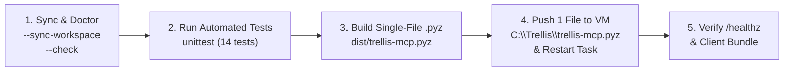

# Deployment & Release Progress Guide (`trellis-mcp`)

**Version:** `v0.1.0`  
**Target Environment:** Windows VM (`<vm-ip>`, user `<domain>\<vm-user>`) or Linux VM  
**Deployment Artifact:** `dist\trellis-mcp.pyz` (`~71 KB` single-file bundle containing all 34 code, standard, template, and skill files)  
**One-Time VM Bootstrap Script:** [`scripts/setup-vm-once.ps1`](../scripts/setup-vm-once.ps1)  
**Recurring Deploy Pipeline Script:** [`scripts/build-and-deploy.ps1`](../scripts/build-and-deploy.ps1)

---

## 1. What We Have Already Done (Completed Milestones)

Every foundational component required for local development, cross-IDE synchronization, multi-key RBAC authentication, and single-file VM deployment has been implemented and verified by automated tests (`[REQ-MCP-01]` through `[REQ-MCP-09]`):

| Status | Requirement ID | Milestone Completed | Verified By |
| :---: | :--- | :--- | :--- |
| `[x]` | **`[REQ-MCP-01]`** | **Zero-Dependency Stdio MCP Server:** JSON-RPC 2.0 server (`initialize`, `ping`, `tools/list`, `tools/call`, `resources/list`, `resources/read`, `prompts/list`, `prompts/get`) in [`trellis_mcp/server.py`](../trellis_mcp/server.py). | `test_req_mcp_01_initialize_and_tools_list` |
| `[x]` | **`[REQ-MCP-02]`** | **8 Callable Trellis MCP Tools + P0/P1 Safety Guards:** Implemented `trellis_get_standard`, `trellis_budget` (`F03` Tier 2/3 auto-upgrade), `trellis_rca` (`F04` PAN/secret redaction block & `F10` concurrency checks), `trellis_spec` (`F12` dual-tier Micro/Full spec), `trellis_enhance` (`F10` Little's Law & I/O Big-O), `trellis_handoff`, `trellis_review`, and `trellis_doctor` (`F02` frontmatter validator) in [`trellis_mcp/tools.py`](../trellis_mcp/tools.py). | `test_req_mcp_02_*` (7 tests) |
| `[x]` | **`[REQ-MCP-03]`** | **Cross-Device Sync & Global Installer:** Implemented `--sync-workspace` and `--install-global` in [`trellis_mcp/installer.py`](../trellis_mcp/installer.py) to sync `.agents/skills/` $\rightarrow$ `.claude/skills/` and install globally into `~/.gemini/config/` and `~/.claude/`. | `test_req_mcp_03_sync_workspace_and_install_global` |
| `[x]` | **`[REQ-MCP-05..06]`** | **Multi-Threaded HTTP MCP Server with Constant-Time Bearer Auth:** Implemented [`TrellisHTTPServer`](../trellis_mcp/http_server.py) (`GET /healthz`, `POST /mcp`, `GET /bundle.json`, `GET /install.sh`) protected by `hmac.compare_digest`. | `test_req_mcp_05_06_http_server_bearer_auth_and_mcp_rpc` |
| `[x]` | **`[REQ-MCP-07]`** | **Zero-Clone Remote Teammate Installer:** Teammates install all rules, `/pb-*` skills, and MCP config from a remote VM via `curl .../install.sh | sh` or `python -m trellis_mcp --install-remote <URL>` without cloning Git. | `test_req_mcp_07_zero_clone_remote_bundle_and_install` |
| `[x]` | **`[REQ-MCP-08]`** | **Administrator API Key Auto-Generation & Team Key RBAC:** Implemented [`TrellisKeyStore`](../trellis_mcp/http_server.py) (`--auto-generate-key`, `--generate-key <label> --role [member\|admin]`, `--list-keys`, `--revoke-key`, plus `GET/POST/DELETE /admin/keys` HTTP endpoints). `member` keys can use `/mcp` and `/bundle.json` but receive `403 Forbidden` on `/admin/keys`. | `test_req_mcp_08_auto_generate_admin_key_and_issue_team_keys`, `test_req_mcp_08_cli_key_management` |
| `[x]` | **`[REQ-MCP-09]`** | **Standalone Single-File `.pyz` Packaging & Windows VM Deploy Pipeline:** Added `--build-pyz` and zip-archive resource loading so `dist\trellis-mcp.pyz` (`~71 KB`) runs on the Windows VM without copying the repository folder tree, paired with [`scripts/build-and-deploy.ps1`](../scripts/build-and-deploy.ps1). | `test_req_mcp_09_build_and_run_standalone_pyz_bundle` |

---

## 2. One-Time Windows VM Setup Checklist (`<vm-ip>`)

Complete these steps **once** on your Windows VM (`<vm-ip>`, `<domain>\<vm-user>`):

- [ ] **Step 2.1 — Bypass or Pause Local TUN Proxy for `<vm-ip>`:**
  - If using the **Happ** TUN client (`happ-default-tun` / `10.6.7.1`) on your local workstation, add `<vm-ip>/32` to the **Direct / Bypass** routing rules so WinRM/RDP/HTTP traffic reaches the VM directly.
- [ ] **Step 2.2 — Verify Python 3.9+ on the Windows VM:**
  - Open **PowerShell as Administrator** on `<vm-ip>` and verify Python is on the system `PATH`:
    ```powershell
    python --version
    ```
- [ ] **Step 2.3 — Run [`scripts/setup-vm-once.ps1`](../scripts/setup-vm-once.ps1) Inside Your RDP Session (`mstsc /v:<vm-ip>`):**
  - On a fresh Windows VM (`<vm-ip>`), only **Port 3389 (RDP)** is open by default (`WinRM 5985` and `Port 8080` are closed until initialized).
  - Copy these 2 files from your local machine (`d:\hta\M.C.Sc_Repo\trellis`) into your RDP session on `<vm-ip>`:
    1. [`dist/trellis-mcp.pyz`](../dist/trellis-mcp.pyz)
    2. [`scripts/setup-vm-once.ps1`](../scripts/setup-vm-once.ps1)
  - Open **PowerShell as Administrator** on the VM in that folder and run:
    ```powershell
    Set-ExecutionPolicy Bypass -Scope Process -Force
    .\setup-vm-once.ps1
    ```
  - This single script creates `C:\Trellis\trellis-mcp.pyz`, opens Windows Firewall for TCP `8080` and WinRM `5985`, registers & starts the `TrellisMCP` background Scheduled Task (`AtStartup`), verifies `http://127.0.0.1:8080/healthz`, and prints your **Administrator API Key (`trl_admin_...`)** and initial **Team Member Key (`trl_team_ibanking_...`)**!
- [ ] **Step 2.5 — Record Your Auto-Generated Admin Key & Issue Your First Team Key:**
  - On the VM, inspect or generate keys against `C:\Trellis\.trellis_keys.json`:
    ```powershell
    # List the auto-generated admin key metadata
    python C:\Trellis\trellis-mcp.pyz --list-keys --keys-file C:\Trellis\.trellis_keys.json

    # Generate a shareable member key for another user or team
    python C:\Trellis\trellis-mcp.pyz --generate-key team-ibanking --role member --keys-file C:\Trellis\.trellis_keys.json
    ```

---

## 3. Recurring Deployment Progress Checklist (For Every Local Change)

Every time you update a standard in `docs/standards/`, edit a skill in `.agents/skills/`, or modify Python code in `trellis_mcp/` on your local machine (`d:\hta\M.C.Sc_Repo\trellis`), follow this **5-step checklist**:



### Checklist to Run on Every Deployment

- [ ] **1. Sync Skills & Run Workspace Doctor (Local):**
  ```powershell
  cd d:\hta\M.C.Sc_Repo\trellis
  python -m trellis_mcp --sync-workspace
  python -m trellis_mcp --check
  ```
  *Expected:* `Status: HEALTHY` (`Zero configuration issues detected`).

- [ ] **2. Run All Requirement-Linked Automated Tests (Local):**
  ```powershell
  python -m unittest tests/test_trellis_mcp.py -v
  ```
  *Expected:* `Ran 14 tests ... OK` (Never deploy if any test fails).

- [ ] **3. Build the Standalone `dist\trellis-mcp.pyz` Artifact (Local):**
  ```powershell
  python -m trellis_mcp --build-pyz dist/trellis-mcp.pyz
  ```
  *Expected:* `Built standalone single-file bundle: ...\dist\trellis-mcp.pyz (34 files, ~71 KB)`.
  *(Note: Steps 1–3 can all be run with a single command: `.\scripts\build-and-deploy.ps1`)*

- [ ] **4. Deploy `dist\trellis-mcp.pyz` to Windows VM (`<vm-ip>`):**
   - **Option A — Zero-WinRM HTTP Hot-Deploy over Port 8080 (`POST /admin/deploy`, Recommended):**
     ```powershell
     .\scripts\build-and-deploy.ps1 -VmHost <vm-ip> -ApiKey "<YOUR_ADMIN_API_KEY>"
     ```
     *Uploads `dist\trellis-mcp.pyz` directly over HTTP port `8080` using your `trl_admin_...` key and hot-reloads the server in memory—no WinRM or `TrustedHosts` required. The script signs the payload with `X-Trellis-Signature: HMAC-SHA256(pyz_bytes, admin_key)`; unsigned uploads are rejected with `400` and invalid signatures with `403`.*
  - **Option B — Automated via WinRM (Auto-Configures `TrustedHosts`):**
    ```powershell
    .\scripts\build-and-deploy.ps1 -VmHost <vm-ip> -VmUser "<domain>\<vm-user>"
    ```
  - **Or Manual via RDP File Copy:**
    1. Stop task on VM: `Stop-ScheduledTask -TaskName "TrellisMCP"`
    2. Replace `C:\Trellis\trellis-mcp.pyz` with your new `dist\trellis-mcp.pyz` *(do not delete `C:\Trellis\.trellis_keys.json` so existing keys stay valid)*.
    3. Start task on VM: `Start-ScheduledTask -TaskName "TrellisMCP"`

- [ ] **5. Post-Deployment Smoke Verification:**
  ```powershell
  # 5a. Check unauthenticated health probe
  Invoke-RestMethod -Uri "http://<vm-ip>:8080/healthz"

  # 5b. Refresh local IDE skills/rules from the updated VM bundle (optional if skills changed)
  python -m trellis_mcp --install-remote http://<vm-ip>:8080 --api-key "<YOUR_API_KEY>"
  ```

---

## 4. Administrator Key Operations Quick Reference

All keys are stored in `C:\Trellis\.trellis_keys.json` on the VM and survive `.pyz` upgrades.

| Operation | CLI Command on VM (`C:\Trellis`) | Remote HTTP Call from Your Workstation |
| :--- | :--- | :--- |
| **Issue Member Key for a User/Team** | `python C:\Trellis\trellis-mcp.pyz --generate-key <team-name> --role member` | `POST http://<vm-ip>:8080/admin/keys` with `{"label": "<team-name>", "role": "member"}` |
| **Issue Another Admin Key** | `python C:\Trellis\trellis-mcp.pyz --generate-key <admin-name> --role admin` | `POST http://<vm-ip>:8080/admin/keys` with `{"label": "<admin-name>", "role": "admin"}` |
| **List All Keys (Masked)** | `python C:\Trellis\trellis-mcp.pyz --list-keys` | `GET http://<vm-ip>:8080/admin/keys` |
| **Revoke Key Immediately** | `python C:\Trellis\trellis-mcp.pyz --revoke-key <key_id_or_label>` | `DELETE http://<vm-ip>:8080/admin/keys/<key_id_or_label>` |

