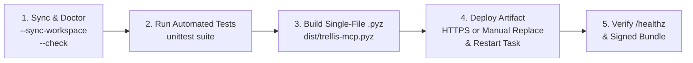

# Deployment & Release Progress Guide (`trellis-mcp`)

**Version:** `v0.1.0`  
**Target Environment:** Windows VM (`<vm-ip>`, user `<domain>\<vm-user>`) or Linux VM  
**Deployment Artifact:** `dist\trellis-mcp.pyz` (single-file bundle containing all code, standard, AI-BOM, template, and skill files)  
**One-Time VM Bootstrap Script:** [`scripts/setup-vm-once.ps1`](../scripts/setup-vm-once.ps1)  
**Recurring Deploy Pipeline Script:** [`scripts/build-and-deploy.ps1`](../scripts/build-and-deploy.ps1)

---

## 1. What We Have Already Done (Completed Milestones)

Every foundational and `SPEC-001` component required for local development, cross-IDE synchronization, multi-AI orchestration, RBAC/scoped authentication, and single-file VM deployment has been implemented and verified by automated tests (`[REQ-MCP-01..10]`, `[REQ-P2/P3-*]`, `[REQ-TRL-01..15]`):

| Status | Requirement ID | Milestone Completed | Verified By |
| :---: | :--- | :--- | :--- |
| `[x]` | **`[REQ-MCP-01]`** | **Zero-Dependency Stdio MCP Server:** JSON-RPC 2.0 server (`initialize`, `ping`, `tools/list`, `tools/call`, `resources/list`, `resources/read`, `prompts/list`, `prompts/get`) in [`trellis_mcp/server.py`](../trellis_mcp/server.py). | `test_req_mcp_01_initialize_and_tools_list` |
| `[x]` | **`[REQ-MCP-02]`** | **8 Callable Trellis MCP Tools + P0/P1 Safety Guards:** Implemented `trellis_get_standard`, `trellis_budget` (`F03` Tier 2/3 auto-upgrade), `trellis_rca` (`F04` PAN/secret redaction block & `F10` concurrency checks), `trellis_spec` (`F12` dual-tier Micro/Full spec), `trellis_enhance` (`F10` Little's Law & I/O Big-O), `trellis_handoff`, `trellis_review`, and `trellis_doctor` (`F02` frontmatter validator) in [`trellis_mcp/tools.py`](../trellis_mcp/tools.py). | `test_req_mcp_02_*` (7 tests) |
| `[x]` | **`[REQ-MCP-03]`** | **Cross-Device Sync & Global Installer:** Implemented `--sync-workspace` and `--install-global` in [`trellis_mcp/installer.py`](../trellis_mcp/installer.py) to sync `.agents/skills/` $\rightarrow$ `.claude/skills/` and install globally into `~/.gemini/config/` and `~/.claude/`. | `test_req_mcp_03_sync_workspace_and_install_global` |
| `[x]` | **`[REQ-MCP-05..06]`** | **Multi-Threaded HTTP MCP Server with Constant-Time Bearer Auth:** Implemented [`TrellisHTTPServer`](../trellis_mcp/http_server.py) (`GET /healthz`, `POST /mcp`, `GET /bundle.json`, `GET /install.sh`) protected by `hmac.compare_digest`. | `test_req_mcp_05_06_http_server_bearer_auth_and_mcp_rpc` |
| `[x]` | **`[REQ-MCP-07]`** | **Zero-Clone Remote Teammate Installer:** Teammates install all rules, `/pb-*` skills, and MCP config from a remote VM via `curl .../install.sh | sh` or `python -m trellis_mcp --install-remote <URL>` without cloning Git. | `test_req_mcp_07_zero_clone_remote_bundle_and_install` |
| `[x]` | **`[REQ-MCP-08..10]`** | **Hashed Admin Key Registry, Expiry, Rotation & RBAC:** Implemented [`TrellisKeyStore`](../trellis_mcp/http_server.py) with salted SHA-256 hashing at rest, Windows ACL locking, `--auto-generate-key` (`stderr` once), `--generate-key <label> --role [member\|admin] --expires-days <N>`, `--list-keys`, `--rotate-key`, `--revoke-key`, plus `GET/POST/PATCH/DELETE /admin/keys`. | `test_req_mcp_08_*`, `test_req_mcp_10_*` |
| `[x]` | **`[REQ-MCP-09]`** | **Standalone Single-File `.pyz` Packaging & Signed Hot-Deploy:** Added `--build-pyz` (`~138 KB`, `53` bundled files) and HMAC-SHA256 signed `POST /admin/deploy` (`X-Trellis-Signature`), paired with [`scripts/build-and-deploy.ps1`](../scripts/build-and-deploy.ps1). | `test_req_mcp_09_build_and_run_standalone_pyz_bundle` |
| `[x]` | **`[REQ-P2-01..06]`** | **Product Depth & Observability:** Added `trellis_test`, `trellis_scan`, `trellis_classify`, `trellis_mcp_registry`, unauthenticated `GET /readyz`, admin-only `GET /metrics`, and doctor dry-run/parity/link validation. | `test_req_p2_01_*` .. `test_req_p2_06_*` |
| `[x]` | **`[REQ-P3-01..07]`** | **IDE Bridge, Provenance, Analytics & Admin Dashboard UI:** Added `--emit-config` (`vscode`, `jetbrains`, `cursor`, `windsurf`, `claude`), `--sync-cache` + `trellis_verify`, `--usage-report` / `trellis_analytics`, and the browser Admin Dashboard ([`ui.py`](../trellis_mcp/ui.py), [`branding.py`](../trellis_mcp/branding.py)) with 15-minute `HttpOnly` sessions, `X-Trellis-CSRF`, nonce-CSP, key editing (`PATCH`), search/filters, and light/dark themes. | `test_req_p3_01_*` .. `test_req_p3_07_*` |
| `[x]` | **`[REQ-TRL-01..15]`** | **`SPEC-001` Hardening, Multi-AI Router, vMF Search & 17 `/pb-*` Unified Skills:** Added `127.0.0.1` loopback bind default, `Origin` allowlist (`403`), `429` auth lockout, per-key tool `--scopes`, redacted JSONL `--audit-log`, MCP `protocolVersion` negotiation, Luhn/JWT/NRC/IBAN redaction, vMF `trellis_search_knowledge`, `trellis_route_model` + [`ai-bom.json`](./standards/ai-bom.json), `trellis_pipeline`, `trellis_synthesize`, A2A `/.well-known/agent.json`, and 17 `/pb-*` skills served over MCP `prompts/*`. | `test_spec_001_upgrades.py` (`12` tests) |
| `[x]` | **`[REQ-TRL-17..30]`** | **`SPEC-002` Security Hardening, Supply-Chain Defense, Threat Model & CI:** Added remote write blocks (`save_to_file`, `auto_fix`), path containment (`_is_within_root()`), read-only member scopes allowlist, deploy signing key separation, non-loopback TLS enforcement, DNS-rebinding protection, signed remote bundle installer, rolling TTL rate/lockout maps, VM script hardening, OSS scrubbing, CI pipeline on Python 3.9-3.13, data-driven verified AI-BOM, vMF vs BM25 benchmark, and STRIDE threat model ([`threat-model.md`](./standards/threat-model.md)). | `test_security_hardening_spec_002.py` (`14` tests), `test_vmf_bm25_benchmark.py` |

---

## 2. One-Time Windows VM Setup Checklist (`<vm-ip>`)

Complete these steps **once** on your Windows VM (`<vm-ip>`, `<domain>\<vm-user>`):

- [ ] **Step 2.1 — Confirm Direct Network Reachability to `<vm-ip>`:**
  - If your workstation uses a split-tunnel VPN or proxy, add `<vm-ip>/32` to direct routing rules so SSH/HTTPS traffic reaches the host directly.
- [ ] **Step 2.2 — Verify Python 3.9+ on the Host:**
  - Open **PowerShell as Administrator** on `<vm-ip>` and verify Python is on the system `PATH`:
    ```powershell
    python --version
    ```
- [ ] **Step 2.3 — Run [`scripts/setup-vm-once.ps1`](../scripts/setup-vm-once.ps1) on the Host:**
  - Copy these 2 files from your local repo (`<REPO_ROOT>`) to the host (plus your TLS certificate and private key):
    1. `dist/trellis-mcp.pyz` (build it first with `python -m trellis_mcp --build-pyz dist/trellis-mcp.pyz`)
    2. [`scripts/setup-vm-once.ps1`](../scripts/setup-vm-once.ps1)
  - Open **PowerShell as Administrator** in that folder and run:
    ```powershell
    .\setup-vm-once.ps1 -BindHost 127.0.0.1 -Port 8080 -AllowedRemoteAddress 127.0.0.1
    # Or directly with TLS on a scoped subnet:
    # .\setup-vm-once.ps1 -BindHost 0.0.0.0 -Port 8443 -TlsCert C:\Trellis\server.crt -TlsKey C:\Trellis\server.key -PublicUrl https://trellis.example.com -AllowedRemoteAddress 10.0.0.0/24
    ```
  - This script copies `trellis-mcp.pyz`, checks for port conflicts without killing other services, adds a scoped firewall rule, registers a least-privilege Scheduled Task (`LocalService`, `Limited`), verifies `/healthz`, and prints your **Administrator API Key (`trl_admin_...`)** and initial read-only **Member Key (`trl_team_alpha_...`)**.
- [ ] **Step 2.4 — Record Your Admin Key & Issue Team Keys:**
  - On the host, inspect or generate keys against `C:\Trellis\.trellis_keys.json`:
    ```powershell
    # List key metadata (masked prefixes & scopes)
    python C:\Trellis\trellis-mcp.pyz --list-keys --keys-file C:\Trellis\.trellis_keys.json

    # Generate a shareable read-only member key for a user or team
    python C:\Trellis\trellis-mcp.pyz --generate-key team-alpha --role member --keys-file C:\Trellis\.trellis_keys.json
    ```

---

## 3. Recurring Deployment Progress Checklist (For Every Local Change)

Every time you update a standard in `docs/standards/`, edit a skill in `.agents/skills/`, or modify Python code in `trellis_mcp/` in your local clone (`<REPO_ROOT>`), follow this **5-step checklist**:



### Checklist to Run on Every Deployment

- [ ] **1. Sync Skills & Run Workspace Doctor (Local):**
  ```powershell
  cd <REPO_ROOT>
  python -m trellis_mcp --sync-workspace
  python -m trellis_mcp --check
  ```
  *Expected:* `Status: HEALTHY` (`Zero configuration issues detected`).

- [ ] **2. Run All Requirement-Linked Automated Tests (Local):**
  ```powershell
  python -m unittest discover -s tests -v
  ```
  *Expected:* All tests pass (`OK`). Never deploy if any test fails.

- [ ] **3. Build the Standalone `dist\trellis-mcp.pyz` Artifact (Local):**
  ```powershell
  python -m trellis_mcp --build-pyz dist/trellis-mcp.pyz
  ```
  *Expected:* `Built standalone single-file bundle: ...\dist\trellis-mcp.pyz`.
  *(Note: Steps 1–3 can all be run with a single command: `.\scripts\build-and-deploy.ps1`)*

- [ ] **4. Deploy `dist\trellis-mcp.pyz` to Host:**
   - **Option A — Signed HTTPS Hot-Deploy (`POST /admin/deploy`, opt-in only via `--enable-remote-deploy` + separate `--deploy-signing-key`):**
     ```powershell
     .\scripts\build-and-deploy.ps1 -ServerUrl https://trellis.example.com -ApiKey "<ADMIN_API_KEY>" -DeploySigningKey "<DEPLOY_SIGNING_KEY>"
     ```
     *Signs payload with `X-Trellis-Signature: HMAC-SHA256(pyz_bytes, deploy_signing_key)` (distinct from the admin bearer token), verifies monotonic version bump, creates `.pyz.bak`, and atomically swaps via `os.replace()`.*
  - **Option B — Manual Artifact Copy (Recommended when `/admin/deploy` remains disabled):**
    1. Stop task on host: `Stop-ScheduledTask -TaskName "TrellisMCP"`
    2. Replace `C:\Trellis\trellis-mcp.pyz` with your new `dist\trellis-mcp.pyz` *(keep `.trellis_keys.json` intact)*.
    3. Start task on host: `Start-ScheduledTask -TaskName "TrellisMCP"`

- [ ] **5. Post-Deployment Smoke Verification:**
  ```powershell
  # 5a. Check unauthenticated readiness and A2A agent card probes
  Invoke-RestMethod -Uri "http://<vm-ip>:8080/healthz"
  Invoke-RestMethod -Uri "http://<vm-ip>:8080/readyz"
  Invoke-RestMethod -Uri "http://<vm-ip>:8080/.well-known/agent.json"

  # 5b. Refresh local IDE skills/rules from the updated VM bundle (optional if skills changed)
  python -m trellis_mcp --install-remote http://<vm-ip>:8080 --api-key "<YOUR_API_KEY>"
  ```

---

## 4. Administrator Key Operations & Dashboard Quick Reference

All keys are stored as salted SHA-256 hashes in `C:\Trellis\.trellis_keys.json` on the VM and survive `.pyz` upgrades. Pass `--scopes` (or `"scopes"` JSON field) when restricting a member key to specific tools, or manage keys interactively in the browser at `http://<vm-ip>:8080/admin/dashboard`.

| Operation | CLI Command on VM (`C:\Trellis`) | Remote HTTP Call / Browser UI |
| :--- | :--- | :--- |
| **Open Browser Admin Dashboard** | N/A | Browse `GET http://<vm-ip>:8080/admin/dashboard` -> signs in via `POST /admin/session` (`HttpOnly` cookie + `X-Trellis-CSRF`) |
| **Issue Member Key for a User/Team** | `python C:\Trellis\trellis-mcp.pyz --generate-key <team-name> --role member --expires-days 90` | `POST /admin/keys` with `{"label": "<team-name>", "role": "member", "expires_days": 90}` |
| **Issue Scoped Member Key** | `python C:\Trellis\trellis-mcp.pyz --generate-key <team-name> --role member --scopes trellis_get_standard,trellis_search_knowledge` | `POST /admin/keys` with `{"label": "<team-name>", "role": "member", "scopes": ["trellis_get_standard"]}` |
| **Issue Another Admin Key** | `python C:\Trellis\trellis-mcp.pyz --generate-key <admin-name> --role admin` | `POST /admin/keys` with `{"label": "<admin-name>", "role": "admin"}` |
| **List All Keys (Masked)** | `python C:\Trellis\trellis-mcp.pyz --list-keys` | `GET /admin/keys` |
| **Edit Key Label / Role** | Use HTTP `PATCH` or Admin Dashboard **Edit** modal | `PATCH /admin/keys/<key_id>` with `{"label": "...", "role": "member\|admin"}` |
| **Rotate Active Key** | `python C:\Trellis\trellis-mcp.pyz --rotate-key <key_id_or_label> --expires-days 90` | Revoke old key + issue replacement |
| **Revoke Key Immediately** | `python C:\Trellis\trellis-mcp.pyz --revoke-key <key_id_or_label>` | `DELETE /admin/keys/<key_id_or_label>` |

