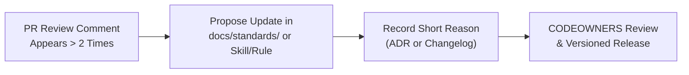

# Engineering Onboarding Guide: `ai-dev-playbook` (Trellis)

**Status:** Working draft v0.1 `[DRAFT]`  
**Source:** [trellis-project-export.md](./knowledge/trellis-project-export.md) (Sections 1, 2, 3, 7, 10, 11)

Welcome to the **Agentic & AI-Driven Engineering Standard** starter kit for **Software Engineers**. This guide explains how to adopt the playbook when developing with **AI agents, foundation models, RAG pipelines, subagents, and MCP tools** in **Claude Code** and **Antigravity IDE**, how to sharpen your engineering and architectural judgment, and how to contribute improvements back to the standard.

---

## 1. Core Workflow (`Plan -> Implement -> Verify -> Review`)

Regardless of which agentic platform, model, or workflow you use, every non-trivial change follows the same four-step loop:

1. **Plan:** Generate an Implementation Plan ([templates/implementation-plan.md](../templates/implementation-plan.md) or Antigravity Implementation Plan artifact). Review the architecture and design critically and approve it **before** instructing AI agents to write feature code.
2. **Implement:** Write the failing test or acceptance criteria first, then implement within the [AI Boundary Standard](./standards/ai-boundary.md) tiers.
3. **Verify:** Run tests, linters, secret scans, and static analysis against the [Testing Standard](./standards/testing-standard.md) and [Security Baseline](./standards/security-baseline.md).
4. **Review:** Produce a Walkthrough ([templates/walkthrough.md](../templates/walkthrough.md)) or PR description ([templates/pull_request_template.md](../templates/pull_request_template.md)) disclosing what changed and where AI agents/models were used, then complete a human code review against the [Definition of Done](./standards/definition-of-done.md).

---

## 2. Getting Started in Each Tool

### 2.1 Using Claude Code `[VERIFIED]`
1. **Local Setup:**
   - Copy `.env.example` to `.env` if local placeholders are needed (never put real secrets in tracked files).
   - Create `CLAUDE.local.md` for personal, machine-local notes (already gitignored).
   - Review `.claude/settings.json` permissions before running on a real repository `[VERIFY]`.
2. **Verify Loaded Context:**
   - Run `/context` in Claude Code to confirm `CLAUDE.md`, `@docs/standards/...` imports, and `.claude/rules/*.md` are loaded.
   - Use `/memory` if you need to inspect or edit memory files.
3. **Daily Commands & Subagents:**
   - Run `/plan-feature` (`.claude/commands/plan-feature.md`) to draft an Implementation Plan and pause for human approval.
   - Run `/test-all`, `/review`, or `/release-checklist` at verification milestones.
   - Delegate isolated checks to read-only subagents (`code-reviewer`, `security-auditor`) or `test-writer` in `.claude/agents/`.

### 2.2 Using Antigravity IDE `[SOURCE: Developers]` `[VERIFY]`
1. **Local Setup:**
   - Configure agent permissions via `/permissions` and set up the browser allowlist/denylist (using the separate Chrome profile) before first use on a real project.
   - Confirm that `GEMINI.md` and `.agents/rules/standards.md` are discovered in your installed Antigravity version `[VERIFY]`.
2. **Daily Workflows, Skills, and Artifacts:**
   - Invoke `/plan-feature` (or `/plan`) to generate an **Implementation Plan artifact**. Review and approve the artifact at the milestone gate before code changes begin.
   - Use workspace skills (`test-writer`, `security-audit`, `code-review`, `perf-test`) in `.agents/skills/` for task-specific runbooks.
   - After implementation, review the **Walkthrough artifact** (`templates/walkthrough.md`), code diffs, and test evidence via `/review` and `/release-checklist`.

---

## 3. Personal Skill-Growth Practices `[DRAFT]`

AI use must make developers **stronger**, not weaker. Practice these four habits daily:

1. **Critique the Plan First:** Read the AI's implementation plan critically before approving; write down what you would have changed or what edge cases the AI missed.
2. **Write the Failing Test Yourself:** Write the failing test or explicit acceptance criteria yourself before asking AI to implement the production code.
3. **Turn Mistakes into Rules:** Whenever AI makes a recurring mistake, turn that lesson into a concise rule or skill-forcing yourself to state the engineering standard explicitly.
4. **Keep Fundamentals Sharp:** Periodically complete a feature, bug fix, or refactoring task **without AI** so your core coding and debugging instincts stay sharp.

---

## 4. The "Review Comment -> Rule" Loop & Contribution Model `[DRAFT]`

Our standard is a living, versioned codebase (`v0.1`, `v0.2`, etc.):

1. **Trigger ("Review Comment -> Rule" Loop):** If the **same review comment appears more than twice** across pull requests (whether caused by AI output or human habit), propose a new rule in `docs/standards/` (and its thin pointer in `.claude/rules/` or `.agents/rules/`) or a task skill.
2. **One Source of Truth:** Always update the canonical policy in `docs/standards/` first (see [ADR 0001](./decisions/0001-single-source-of-truth.md)), rather than editing only one tool's config folder.
3. **Record the Rationale:** Every change to a rule, hook, or AI-boundary tier must include a short reason in an ADR (`docs/decisions/`) or changelog entry.
4. **Pull Request & `CODEOWNERS`:** Submit changes via Pull Request for review by the named standard owner (`TODO [TO RESEARCH]: confirm named standard owner in Phase 0`).
