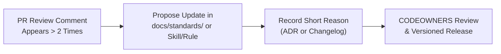

# Engineering Onboarding Guide: `ai-dev-playbook` (Trellis)

**Status:** Working draft v0.1 `[DRAFT]`  
**Source:** [trellis-project-export.md](./knowledge/trellis-project-export.md) (Sections 1, 2, 3, 7, 10, 11)

Welcome to the **Agentic & AI-Driven Engineering Standard** starter kit for **Software Engineers**. This guide explains how to adopt the playbook when developing with **AI agents, foundation models, RAG pipelines, subagents, and MCP tools** in **Claude Code** and **Antigravity IDE**, how to sharpen your engineering and architectural judgment, and how to contribute improvements back to the standard.

---

## 1. Core Workflow (`Plan -> Implement -> Verify -> Review`)

Regardless of which agentic platform, model, or workflow you use, every non-trivial change follows the same four-step loop:

1. **Plan:** Generate an Implementation Plan ([templates/implementation-plan.md](../templates/implementation-plan.md) or Antigravity Implementation Plan artifact). Review the architecture and design critically and approve it **before** instructing AI agents to write feature code.
2. **Implement:** Write the failing test or acceptance criteria first, then implement within the [AI Boundary Standard](./standards/ai-boundary.md) tiers.
3. **Verify:** Run tests, linters, secret scans, and static analysis against the [Testing Standard](./standards/testing-standard.md) and [Security Baseline](./standards/security-baseline.md).
4. **Review:** Produce a Walkthrough ([templates/walkthrough.md](../templates/walkthrough.md)) or PR description ([templates/pull_request_template.md](../templates/pull_request_template.md)) disclosing what changed and where AI agents/models were used, then complete a human code review against the [Definition of Done](./standards/definition-of-done.md).

---

## 2. Getting Started in Each Tool (Workspace & Any Device)

### 2.0 Install Globally Across Your Device (`trellis-mcp`)
To make all Trellis `/pb-*` slash skills, rules, and MCP tools available in **every project on your machine** (Antigravity IDE, Claude Code, Cursor, VS Code):
```bash
# Option A: Local machine install (from a central ~/trellis clone; use `python` on Windows)
python3 -m trellis_mcp --install-global

# Validate workspace rules, skill line budgets, and YAML frontmatter
python3 -m trellis_mcp --check
```

#### Option B: Private VM Hosting, Admin Key Auto-Generation & Zero-Clone Teammate Setup (`[REQ-MCP-05..08]`)
1. **On your Private VM (Start Server & Auto-Generate Admin Key):**
   ```bash
   # Auto-generates & persists an admin key (trl_admin_...) in .trellis_keys.json (0600)
   python3 -m trellis_mcp --serve-http --auto-generate-key --host 0.0.0.0 --port 8080
   ```
2. **As Administrator — Generate, List, or Revoke Keys for Another User or Team:**
   ```bash
   # Via CLI on the VM (no restart required):
   python3 -m trellis_mcp --generate-key team-ibanking --role member
   python3 -m trellis_mcp --list-keys
   python3 -m trellis_mcp --revoke-key team-ibanking

   # Or remotely via HTTP POST /admin/keys:
   curl -s -X POST http://<vm-ip>:8080/admin/keys \
     -H "Authorization: Bearer <ADMIN_API_KEY>" \
     -H "Content-Type: application/json" \
     -d '{"label": "team-ibanking", "role": "member"}'
   ```
3. **On any teammate's machine (Zero Git Clone required):**
   ```bash
   # macOS / Linux / WSL / Git Bash:
   export TRELLIS_API_KEY="<team-member-api-key>"
   curl -fsSL -H "Authorization: Bearer $TRELLIS_API_KEY" http://<vm-ip>:8080/install.sh | sh

   # Windows PowerShell:
   python -m trellis_mcp --install-remote http://<vm-ip>:8080 --api-key "<team-member-api-key>"
   ```
   Or configure `~/.gemini/config/mcp_config.json` directly:
   ```json
   {
     "mcpServers": {
       "trellis-mcp": {
         "serverUrl": "http://<vm-ip>:8080/mcp",
         "headers": {
           "Authorization": "Bearer <team-member-api-key>"
         }
       }
     }
   }
   ```

### 2.1 Using Claude Code `[VERIFIED]`
1. **Local Setup:**
   - Copy `.env.example` to `.env` if local placeholders are needed (never put real secrets in tracked files).
   - Create `CLAUDE.local.md` for personal, machine-local notes (already gitignored).
   - Review `.claude/settings.json` permissions before running on a real repository `[VERIFY]`.
2. **Verify Loaded Context:**
   - Run `/context` in Claude Code to confirm `CLAUDE.md`, `@docs/standards/...` imports, `.claude/rules/*.md`, and `trellis-mcp` tools are loaded.
   - Use `/memory` if you need to inspect or edit memory files.
3. **Daily Commands, MCP Tools & Subagents:**
   - Run `/pb-spec` or `/pb-plan` to draft a Spec or Implementation Plan and pause for human approval.
   - Run `/pb-rca` for 9-step root-cause analysis, `/pb-enhance` for Little's Law & complexity sizing, `/pb-handoff` before `/clear`, and `/pb-review` or `/pb-release-check` at verification milestones.
   - Delegate isolated checks to read-only subagents (`code-reviewer`, `security-auditor`) or `test-writer` in `.claude/agents/`.

### 2.2 Using Antigravity IDE `[VERIFIED]`
1. **Local Setup:**
   - Run `python -m trellis_mcp --install-global` once per machine so `~/.gemini/config/plugins/trellis/` and `~/.gemini/config/mcp_config.json` are registered globally.
   - Confirm that `GEMINI.md` and `.agents/rules/*.md` (each with `trigger: always_on` YAML frontmatter) are loaded in the Customize -> Rules panel.
2. **3-Surface Command Comparison Table (`F05`):**

| Surface | Built-in / Custom Commands | Where Defined | Purpose |
| :--- | :--- | :--- | :--- |
| **1. Antigravity IDE Built-in Slash (`/`)** | `/plan`, `/goal`, `/compact`, `/schedule`, `/browser`, `/grill-me`, `/teamwork-preview`, `/learn`, `/boost` | Built into Antigravity IDE chat UI | Native IDE agent modes (planning, context compaction, browser, deep reasoning) |
| **2. Claude Code CLI Built-in Slash (`/`)** | `/clear`, `/compact`, `/context`, `/cost`, `/doctor`, `/init`, `/mcp`, `/memory`, `/model`, `/permissions`, `/plan`, `/review` | Built into Claude Code CLI | Session management, token/cost inspection, permission gates |
| **3. Trellis Custom Skills & MCP Tools (`/pb-*` & `trellis_*`)** | `/pb-rca` (`trellis_rca`), `/pb-spec` (`trellis_spec`), `/pb-enhance` (`trellis_enhance`), `/pb-handoff` (`trellis_handoff`), `/pb-review` (`trellis_review`), `/pb-plan`, `/pb-release-check`, `trellis_budget`, `trellis_get_standard`, `trellis_doctor` | `.agents/skills/*/SKILL.md`, `.claude/skills/*/SKILL.md`, and `trellis_mcp` server | Enforced Trellis engineering workflows, Tier 3 redaction gates, and Little's Law / quota guards |

---

## 3. Personal Skill-Growth Practices `[DRAFT]`

AI use must make developers **stronger**, not weaker. Practice these four habits daily:

1. **Critique the Plan First:** Read the AI's implementation plan critically before approving; write down what you would have changed or what edge cases the AI missed.
2. **Write the Failing Test Yourself:** Write the failing test or explicit acceptance criteria yourself before asking AI to implement the production code.
3. **Turn Mistakes into Rules:** Whenever AI makes a recurring mistake, turn that lesson into a concise rule or skill-forcing yourself to state the engineering standard explicitly.
4. **Keep Fundamentals Sharp:** Periodically complete a feature, bug fix, or refactoring task **without AI** so your core coding and debugging instincts stay sharp.

---

## 4. The "Review Comment -> Rule" Loop & Contribution Model `[DRAFT]`

Our standard is a living, versioned codebase (`v0.1`, `v0.2`, etc.):



1. **Trigger ("Review Comment -> Rule" Loop):** If the **same review comment appears more than twice** across pull requests (whether caused by AI output or human habit), propose a new rule in `docs/standards/` (and its thin pointer in `.claude/rules/` or `.agents/rules/`) or a task skill.
2. **One Source of Truth:** Always update the canonical policy in `docs/standards/` first (see [ADR 0001](./decisions/0001-single-source-of-truth.md)), rather than editing only one tool's config folder.
3. **Record the Rationale:** Every change to a rule, hook, or AI-boundary tier must include a short reason in an ADR (`docs/decisions/`) or changelog entry.
4. **Pull Request & `CODEOWNERS`:** Submit changes via Pull Request for review by the named standard owner (`TODO [TO RESEARCH]: confirm named standard owner in Phase 0`).
