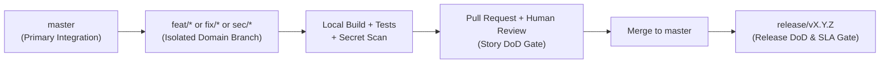

# Git Convention and Commit Guidelines (Enterprise Banking Standard)

**Status:** Working standard v0.1 (Aligned with Angular Conventional Commits & Enterprise Banking Standards)  
**Source:** Adapted from Enterprise Financial Web Application Git Convention Patterns  
**Related Standards:** [definition-of-done.md](./definition-of-done.md), [testing-standard.md](./testing-standard.md), [security-baseline.md](./security-baseline.md)

---

## 1. Quick Reference Cheat Sheet (TL;DR)

### The 5 Golden Rules
1. **Format:** `<type>(<scope>): <summary in imperative tense>`
2. **Subject Line:** Maximum **72 characters**, start with **lowercase**, and **no trailing period** (use `add`, `fix`, `switch`, `adjust` — **never** `added`, `fixes`, `updated`, or `Updated.`).
3. **Traceability & Clarity:** Always specify the affected domain/module scope (e.g., `feat(router): ...` or `sec(session): ...` instead of vague messages like `updated` or `route mapping`).
4. **Branching:** Use semantic branch names matching `<type>/<feature-or-fix-description>` (e.g., `feat/transfer`, `feat/account`, `fix/login-redirect`, `sec/session-timeout`).
5. **Pre-Push Verification:** Always run the project build, linter, secret scan, and test suite locally before pushing to guarantee build integrity.

```text
       +--------------------------------------------------------+
       |             WHAT TYPE SHOULD I USE?                    |
       +--------------------------------------------------------+
       | New banking feature?         --> feat(...)             |
       | Bug fix in UI or logic?      --> fix(...)              |
       | Security / session timeout?  --> sec(...)              |
       | Regulatory / audit logging?  --> audit(...)            |
       | Refactoring architecture?    --> refactor(...)         |
       | Performance optimization?    --> perf(...)             |
       | Dependencies / build budget? --> build(...)            |
       | Unit / E2E test updates?     --> test(...)             |
       | Documentation or guides?     --> docs(...)             |
       | CI pipeline / deployment?    --> ci(...)               |
       | Code formatting (no logic)?  --> style(...)            |
       | Repository maintenance?      --> chore(...)            |
       +--------------------------------------------------------+
```

---

## 2. Commit Message Specification

### 2.1 Commit Structure & Format

Every commit message consists of a **header**, an optional **body**, and an optional **footer**:

```text
<type>(<scope>): <short summary in present imperative tense>

[optional body explaining motivation, regulatory requirement, or technical rationale]

[optional footer(s): BREAKING CHANGE, Closes #issue-ref, Security Review Ref]
```

### 2.2 Commit Types (Banking Standard)

| Type | Banking Use Case / Meaning | SemVer Impact |
| :--- | :--- | :--- |
| `feat` | New banking feature or business capability | **MINOR** (`0.1.0`) |
| `fix` | Bug fix in calculations, rendering, or transaction flow | **PATCH** (`0.0.1`) |
| `sec` | Security fix, token revocation, sanitization, idle logout, CSP/headers | **PATCH** (`0.0.1`) |
| `audit` | Audit trail logging, KYC validation, regulatory reporting rules | **PATCH** (`0.0.1`) |
| `refactor` | Code refactoring (Clean Architecture, DI bindings) without behavior change | **PATCH** (`0.0.1`) |
| `perf` | Performance improvement (query tuning, bundle size, lazy loading) | **PATCH** (`0.0.1`) |
| `build` | Build tool, dependencies, compiler config, style budgets | None |
| `ci` | CI/CD pipelines, GitHub Actions / Azure DevOps scripts | None |
| `test` | Adding or updating unit, integration, contract, or E2E tests | None |
| `docs` | Documentation updates (`README.md`, `docs/*.md`, ADRs) | None |
| `style` | Code formatting, whitespace, semicolons (no logic change) | None |
| `chore` | Maintenance tasks, version bumps, `.gitignore` or environment templates | None |

### 2.3 Commit Rules & Standards

1. **Header Line:** Maximum **72 characters**.
2. **Subject:**
   - Use **imperative, present tense**: `"add"`, `"fix"`, `"remove"`, `"switch"`, `"adjust"` (**never** `"added"`, `"fixing"`, `"switched"`, `"updated"`).
   - Do **not** capitalize the first letter of the subject.
   - Do **not** put a period (`.`) at the end.
3. **Body Text:**
   - Explain the motivation for the change and contrast it with previous behavior.
   - Wrap body lines at **72 characters**.
4. **Security & AI Boundary Compliance:**
   - Never include credentials, tokens, internal hostnames, or real customer PII in commit messages (see [security-baseline.md](./security-baseline.md) and [ai-boundary.md](./ai-boundary.md)).

---

## 3. Scope Conventions

Each repository must define a clear **Scope Matrix** mapping commit scopes to domain modules or directories.

### 3.1 Playbook / Standards Repository Scopes (`trellis`)

When committing to this `ai-dev-playbook` (`trellis`) repository, use these scopes:

| Scope | Target Location | Purpose |
| :--- | :--- | :--- |
| `standards` | `docs/standards/*` | Canonical testing, DoD, AI boundary, security, performance, and git standards |
| `decisions` | `docs/decisions/*` | Architecture Decision Records (ADRs) |
| `docs` | `README.md`, `docs/onboarding.md`, `docs/knowledge/*` | Onboarding guides, repository documentation, and research exports |
| `claude` | `CLAUDE.md`, `.claude/**` | Claude Code rules, commands, skills, subagents, settings, and hooks |
| `agents` | `GEMINI.md`, `.agents/**` | Antigravity IDE rules, workflows, and skills |
| `templates` | `templates/*` | Implementation plan, walkthrough, test plan, and PR templates |
| `scripts` | `scripts/*` | Tool configuration sync and validation scripts/notes |
| `git` | `.gitignore`, `.env.example`, `.mcp.json` | Repository-level tracking and baseline configuration |

### 3.2 Reference Financial Application Scope Matrix (Example: `example-portal`)

When adopting this standard in a digital banking or financial web application, map scopes to clean-architecture layers and domain modules:

| Scope | Target Codebase Location (Example) | Typical Domain Responsibility |
| :--- | :--- | :--- |
| `router` | `src/app/app.routes.ts`, `app.config.ts`, `projects/**/routes.ts` | PathLocation strategy, root navigation, lazy routes |
| `auth` | `projects/iam/src/app/features/login`, `verify`, `change-password` | Login credentials, MFA/OTP verification, password reset |
| `session` | `src/app/guards/auth.guard.ts`, `src/app/interceptors/auth.interceptor.ts` | Token lifecycle, auto-logout on 401/403, session expiry |
| `transfers` | `projects/portal/src/app/features/transfers/*` | Own/other account transfer, payee transfer, transfer progress |
| `accounts` | `projects/portal/src/app/features/accounts/*` | Account balance inquiry, transaction history, statement download |
| `dashboard` | `projects/portal/src/app/features/dashboard/*` | Financial overview, account summary cards, quick actions |
| `payments` | `projects/portal/src/app/features/payments/*` | Bill payments, utility payments, merchant QR transactions |
| `cheques` | `projects/portal/src/app/features/cheques/*` | Cheque inquiry, stop payment, cheque book ordering |
| `authz` | `projects/portal/src/app/features/authorization/*` | Maker-checker approval matrix and corporate workflow |
| `settings` | `projects/portal/src/app/features/settings/*` | Payee management, standing instructions (SI), user profile |
| `layout` | `src/app/components/layout/`, `sidebar/`, `navbar/` | Main shell drawer, collapsible menu, header alerts |
| `core` | `src/app/core/*` | Clean Architecture domain ports, use-cases, and repositories |
| `config` | `src/app/services/config.service.ts`, `src/assets/config.json` | API URLs, app ID, runtime toggles |
| `firebase` | `src/app/services/firebase.service.ts`, `public/firebase-*.js` | Push notifications, analytics, screen logging |
| `i18n` | `src/assets/i18n/*` | Multi-language translation keys |
| `security` | `staticwebapp.config.json`, CSP headers, cookie policies | Content-Security-Policy, HSTS, secure cookie attributes |

---

## 4. Good vs. Bad Commit Examples (Case Studies)

### Example 1: Endpoint & Routing Upgrade
- **Bad:** `git commit -m "route mapping"` *(Vague, missing type and scope)*
- **Bad:** `git commit -m "feat: Updated localhost 4200 portal URL"` *(Capitalized, past tense, missing scope)*
- **Good:**
  ```text
  feat(router): switch from hash routing to path-based location strategy

  - remove withHashLocation from provideRouter in app.config.ts
  - map default startup endpoint directly to /portal
  - update analytics service to resolve screen name from location pathname
  ```

### Example 2: Build Budget Threshold Adjustment
- **Bad:** `git commit -m "updated"` *(Zero information about what changed)*
- **Bad:** `git commit -m "fix: change angular json"` *(Incorrect type, vague subject)*
- **Good:**
  ```text
  build(angular): adjust component style budget threshold for production

  - increase anyComponentStyle budget in angular.json to 24kB
  - resolve style size constraint on other-accounts component
  ```

### Example 3: Transfer Feature Implementation
- **Bad:** `git commit -m "pay&transfer landing page, and other accounts transfer"` *(Missing type/scope, informal syntax)*
- **Good:**
  ```text
  feat(transfers): add pay and transfer landing page and transfer workflow

  - create transfer option cards on pay-transfer landing page
  - implement other accounts transfer multi-step form
  ```

### Example 4: Security Session Invalidation
- **Bad:** `git commit -m "fix session logout"`
- **Good:**
  ```text
  sec(session): enforce token revocation and redirect on 401 error

  - clear authentication cookies and local cache on HTTP 401/403 response
  - display session expired notification and navigate to /login
  ```

---

## 5. Branch Naming Convention & Git Flow

### 5.1 Semantic Branch Naming (`<type>/<feature-or-fix-description>`)

| Category | Branch Naming Format | Examples |
| :--- | :--- | :--- |
| **Feature Branches** | `feat/<feature-name>` | `feat/transfer`, `feat/account`, `feat/router-upgrade`, `feat/maker-checker` |
| **Bug Fix Branches** | `fix/<defect-name>` | `fix/route-mapping`, `fix/transfer-button-debounce`, `fix/balance-inquiry-currency` |
| **Security Branches** | `sec/<security-issue>` | `sec/session-timeout`, `sec/csp-headers`, `sec/sanitize-transfer-input` |
| **Refactoring** | `refactor/<target-area>` | `refactor/clean-architecture-ports`, `refactor/account-usecases` |
| **Documentation / Standards** | `docs/<topic>` | `docs/git-convention`, `docs/testing-standard` |
| **Emergency Fixes** | `hotfix/<prod-incident>` | `hotfix/token-revocation`, `hotfix/cors-origin` |
| **Releases** | `release/<version>` | `release/v1.0.0`, `release/v1.1.0` |

### 5.2 Branch Roles & Integration Flow



1. **`master` (Primary Integration Branch):** Central active development and integration branch. Force-pushing to `master` is strictly prohibited (enforced by `.claude/settings.json` and `validate-bash.sh`).
2. **`feat/*` (Domain Feature Branches):** Dedicated branches for isolated domain work, merged back into `master` via Pull Request after Story-level DoD review.
3. **`fix/*`, `sec/*`, `hotfix/*` (Defect, Security & Emergency Patches):** Branched off `master` to address defects, security findings, or production incidents.
4. **`release/*` (Release Milestones):** Tagged release branches (`v1.0.0`, `v1.1.0`) gated by the Release-level Definition of Done ([definition-of-done.md](./definition-of-done.md)).

### 5.3 Developer Daily Workflow (5 Steps)

1. **Synchronize `master`:**
   ```bash
   git checkout master
   git pull origin master
   ```
2. **Create a semantic branch:**
   ```bash
   git checkout -b feat/transfer
   ```
3. **Verify locally before staging:**
   - Run the project build, unit/integration tests, linter, and secret scan (see [testing-standard.md](./testing-standard.md) and [security-baseline.md](./security-baseline.md)).
4. **Stage explicit files and commit in Conventional Commit format:**
   ```bash
   git add <explicit-files>
   git commit -m "feat(transfers): add transfer progress review and receipt pages"
   ```
5. **Push branch and open a Pull Request:**
   ```bash
   git push origin feat/transfer
   ```
   - Complete [templates/pull_request_template.md](../../templates/pull_request_template.md) and obtain human code review before merging into `master`.

---

## 6. Automated Governance (Husky + Commitlint Reference Setup)

For Node/TypeScript/Angular repositories, enforce commit message compliance automatically before commits leave the developer workstation:

### 6.1 Reference `.commitlintrc.json`
```json
{
  "extends": ["@commitlint/config-conventional"],
  "rules": {
    "type-enum": [
      2,
      "always",
      [
        "feat",
        "fix",
        "sec",
        "audit",
        "refactor",
        "perf",
        "build",
        "ci",
        "docs",
        "test",
        "style",
        "chore"
      ]
    ],
    "subject-case": [2, "never", ["upper-case", "pascal-case"]],
    "subject-full-stop": [2, "never", "."],
    "header-max-length": [2, "always", 72]
  }
}
```

---

## 7. Semantic Versioning (SemVer 2.0.0)

Release versioning follows `MAJOR.MINOR.PATCH`:
- **MAJOR (`1.0.0 → 2.0.0`):** Breaking architectural redesign or incompatible API changes (`BREAKING CHANGE` footer).
- **MINOR (`1.0.0 → 1.1.0`):** Backward-compatible new banking feature (`feat`).
- **PATCH (`1.0.0 → 1.0.1`):** Backward-compatible bug fix, security patch, audit rule, refactor, or performance improvement (`fix`, `sec`, `audit`, `refactor`, `perf`).
