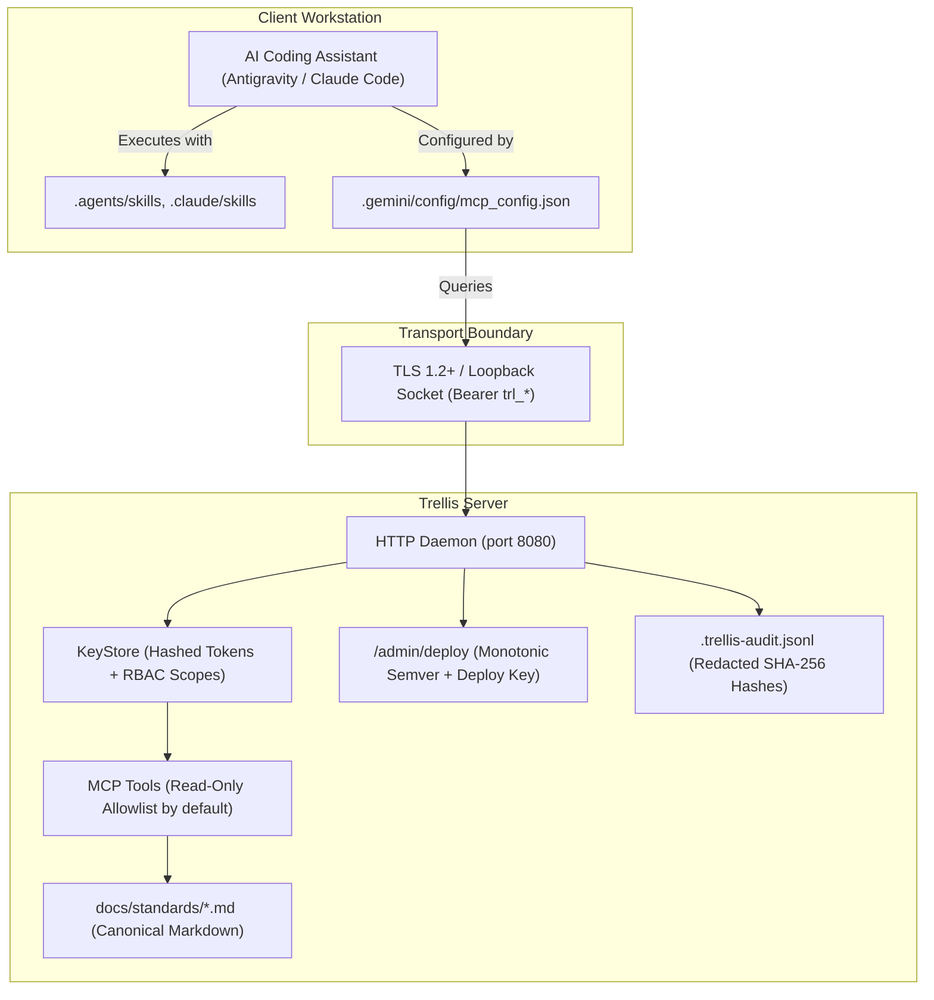

# Trellis Threat Model (`[REQ-TRL-30]`)

**Status:** Approved Standard (`2026-11-21`)  
**Scope:** Trellis MCP server, HTTP daemon, zero-clone remote installer, agent prompt distribution, and client workstations.  
**Standard Authority:** [ADR 0001](../decisions/0001-single-source-of-truth.md), [SPEC-001](../specs/001-secure-multi-ai-trellis.md), [SPEC-002](../specs/002-security-hardening.md).

---

## 1. Overview & Trust Boundaries

Trellis functions as a **policy and governance control plane** distributing engineering standards, model routing policies, and security guardrails to AI coding assistants (such as Antigravity and Claude Code). Because Trellis distributes instructions that guide autonomous agent code execution, protecting the integrity and confidentiality of the control plane is essential.

---

## 2. Core Assets & Protection Objectives

| Asset | Location | Security Objective | Criticality |
|---|---|---|---|
| **API Keystore** | `.trellis_keys.json` | Confidentiality, Integrity. Kept with mode `0600`; salted SHA-256 hashes only. Plaintext tokens never stored. | **P0** |
| **Canonical Standards** | `docs/standards/*.md` | Integrity. Prevent unauthorized writes from poisoning instructions distributed to AI agents. | **P0** |
| **Executable Bundle** | `dist/trellis-mcp.pyz` | Integrity. Atomic swap, separate deploy signing key, semver monotonicity check. | **P0** |
| **Client Workspace Configs** | `~/.gemini/config/`, `~/.claude/` | Integrity. Prevent silent deletion or replacement of existing MCP servers upon install. | **P1** |
| **Structured Audit Log** | `.trellis-audit.jsonl` | Non-repudiation, Confidentiality. Redacted tokens, PANs, PII; SHA-256 body digests. | **P1** |

---

## 3. Threat Actors & Profiles

1. **Authenticated Member Developer:** Holds a `trl_<label>_*` bearer token. Intended only for read-only standard retrieval, routing queries, and DoD verification.
2. **Server Administrator:** Holds an admin-role bearer token. Authorized for key issuance, key rotation, and diagnostic metrics.
3. **Unauthenticated Network Attacker:** Adjacent on local network or public Internet probing open port 8080, attempting auth brute-forcing, DNS rebinding, or header spoofing.
4. **Malicious / Compromised Skill Author:** Submitting poisoned skills or prompt injections intended to trick agent workflows into exfiltrating credentials or bypassing security gates.

---

## 4. STRIDE Threat Analysis & Mitigations

### 4.1 Spoofing (Identity & Origin)
- **Threat:** Attacker spoofs client IP via `X-Forwarded-For` to bypass rate limits, or crafts malicious `Host` headers for DNS rebinding.
- **Mitigations:**
  - `X-Forwarded-For` is only honored from explicitly configured `--trusted-proxy` IPs (`[REQ-TRL-23]`).
  - `Host` header is validated against an allowlist (loopback + configured public URL) (`[REQ-TRL-21]`).
  - Plaintext tokens cannot authenticate without running `migrate_legacy_plaintext_keys()` (`[REQ-TRL-23]`).
  - Strict Origin validation on `/mcp` blocks arbitrary browser origins with `403 Forbidden` (`[REQ-TRL-01]`).

### 4.2 Tampering (Data & Code Integrity)
- **Threat:** Low-privilege remote client calls tools with `save_to_file` or `auto_fix` to overwrite canonical standards on the server (`F1`), escapes directory containment via `../trellis-evil` (`F2`), or uploads malicious `.pyz` via `/admin/deploy` (`F3`).
- **Mitigations:**
  - Remote calls strictly reject `save_to_file` and `auto_fix` arguments (`[REQ-TRL-17]`).
  - Arguments starting with `_` (e.g. `_remote_mode`) are stripped from incoming requests before injecting server context (`[REQ-TRL-17]`).
  - Path containment helper `_is_within_root()` resolves paths and rejects symlink escapes or sibling directory escapes (`[REQ-TRL-19]`).
  - `/admin/deploy` is disabled by default (`enable_remote_deploy=False`), requires a distinct `deploy_signing_key`, validates version monotonicity, and performs atomic replacement via temporary file swap (`[REQ-TRL-20]`).
  - Remote installer verifies HMAC signatures by default (`[REQ-TRL-22]`).

### 4.3 Repudiation (Auditability)
- **Threat:** Malicious action performed on the server is denied by the user.
- **Mitigations:**
  - Structured JSONL audit log (`.trellis-audit.jsonl`) logs every request with timestamp, caller prefix/label, tool name, client IP, and SHA-256 body hash (`[REQ-TRL-02]`).
  - Sensitive tokens and PAN/PII are redacted before writing to log (`[REQ-TRL-02]`).

### 4.4 Information Disclosure (Confidentiality)
- **Threat:** Leaking customer PII/PAN, API tokens, internal server directory paths, or private VPN addresses in error messages, logs, or public git repos (`F13`).
- **Mitigations:**
  - Luhn PAN, JWT, Myanmar NRC, IBAN, and secret regex redactions applied automatically across prompts and logs (`[REQ-TRL-05]`).
  - Scrubbed personal local directories (`d:\hta`), private VPN IPs (`10.6.7.1`), and company-specific names from tracked files (`[REQ-TRL-25]`).
  - Public repository includes `SECURITY.md` directing vulnerability reports to GitHub Private Vulnerability Reporting (`[REQ-TRL-25]`).

### 4.5 Denial of Service (Availability)
- **Threat:** Auth brute-force attempts flood the server; unevicted IP maps in memory cause unbounded memory growth (`F8`).
- **Mitigations:**
  - Repeated 401 authentication failures trigger 429 lockout (`[REQ-TRL-03]`).
  - Rate-limit and lockout tracking maps evict stale entries using rolling TTL expiration (`[REQ-TRL-23]`).

### 4.6 Elevation of Privilege (Authorization)
- **Threat:** Member token calls administrative tools; service registered as SYSTEM scheduled task runs arbitrary code as local SYSTEM (`F5`).
- **Mitigations:**
  - Member keys default to a strict read-only allowlist of 13 safe tools (`[REQ-TRL-18]`).
  - VM bootstrap scripts remove SYSTEM scheduled task execution, WinRM `Any` IP listeners, and hardcoded local directories (`[REQ-TRL-24]`).
  - TLS enforcement: non-loopback bindings (`0.0.0.0`) refuse to start without TLS certificates unless `--insecure-http` is passed explicitly (`[REQ-TRL-21]`).

---

## 5. Residual Risks & Best-Effort Controls

1. **Prompt Injection:** Heuristic regex patterns in `_INJECTION_PATTERNS` filter common injection signatures on a best-effort basis (`[REQ-TRL-29]`). They do not replace containerized or sandboxed AI tool execution.
2. **Local Client Tool Execution:** AI coding agents executing commands locally on developer machines are governed by client-side hooks (`.claude/hooks/validate-bash.sh`, `run-tests.sh`) as a defense-in-depth safety net (`[REQ-TRL-26]`).
